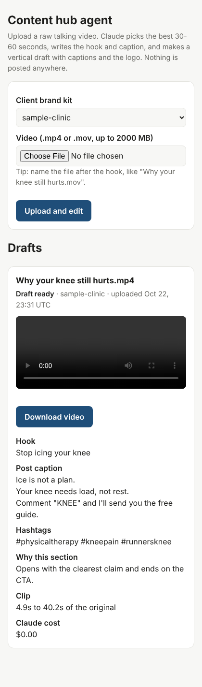

# Content hub editing agent (prototype)

A worker that turns a client's raw talking video into a first-draft Instagram Reel,
or a raw course recording into a finished-looking lesson, ready for a human to review. It is the "engine" piece of Greg's content hub: the
client uploads, this makes the draft, Greg or Katrina approve it.


*(Test pattern video, made-up client "Sample Clinic". Hook pill at the top in the
client's color, logo top-right, 3-word captions low on screen.)*

## What it does, in plain words

1. **Listens to the video.** Whisper (running on the server) writes out every word with
   its exact time.
2. **Reads the client's brand kit.** Voice, audience, offers, words they never say, call
   to action, colors, logo.
3. **Claude picks the best 30-60 seconds.** It looks for the section with the strongest
   opening line that makes one point and ends on a complete thought, following the
   rules in `.claude/skills/` (Greg's know-how goes there as plain files).
4. **Claude writes the words.** A short on-screen hook and the Instagram post caption,
   in the client's voice.
5. **ffmpeg makes the video.** Cuts the section, fills a vertical 1080x1920 frame, burns
   in captions and the hook, adds the logo.
6. **Saves a draft folder** with the video and a `post.json` (hook, caption, hashtags, and
   one line on why Claude chose that section), marked `needs_review`.

Nothing is posted anywhere. Every draft waits for a person.

## Course lessons (Katrina's course edit skill)

Pick **Course lesson** on the upload page. This runs Katrina's `edit-course-lesson`
skill (from her HyperFrames student kit) on the server:

1. **Whisper** writes out every word, then the kit's **cut-silences** script trims dead air
   (teaching keeps its breathing room).
2. **Claude reviews the mistake candidates** the kit's cut-mistakes detector finds
   (stutters, false starts, re-said lines) and cuts only the clear ones. No one approves
   them live, so when in doubt it keeps the line.
3. **Claude writes the lesson plan**: a title card while the camera is full screen, then
   the camera shrinks into a rounded box beside big takeaways, section cards and image
   aids, each timed to the exact words. It looks at a frame to keep the face inside the box.
   The kit's builder checks the plan and Claude fixes whatever it reports.
4. **Higgsfield makes the image aids** (flat illustrations in the Healthy Free Life colors).
   Claude opens each one and redoes any with text or clutter. Needs `HIGGSFIELD_API_KEY`;
   without it the lesson is made without pictures.
5. **HyperFrames renders the lesson** (1920x1080) in the Healthy Free Life look, using
   Chrome on the server.

The page shows the video, Claude's note for the reviewer, the cuts it made, how many
images it made, and the Claude cost. The whole project folder (plan, timing table,
images) stays in `drafts/<client>/<video>-<time>/` so a lesson can be re-tuned and
re-rendered by hand with the kit.

Differences from running the skill by hand in Claude Code: no slide decks yet, mistake
cuts and image spend are not approved one by one (images are capped at
`MAX_COURSE_IMAGES`, default 10 per lesson), and the image model is Higgsfield's
**Recraft V4.1** through the Higgsfield API, because the GPT Image model the skill uses
through the Higgsfield connector is not offered in their API. Set
`HIGGSFIELD_IMAGE_MODEL` to try another of their text-to-image endpoints.

**Speed:** rendering is the slow part. Here a 21-second lesson took 84 seconds to
render on one Chrome worker, so a 10-minute lesson can take 30-60 minutes on Railway.

## How it is built

| Piece | Choice | Why |
| --- | --- | --- |
| Language | Python | Greg's existing editing pipelines (`sshcvirtual/claude-video-edits`) are Python, so their validated steps can be moved in later. |
| Agent | [Claude Agent SDK](https://code.claude.com/docs/en/agent-sdk) | Loads Greg's skills straight from `.claude/skills/`, runs our tools in-process, has per-video turn and dollar limits. |
| Model | `claude-opus-5-5`, effort `medium` | Change with `CLAUDE_MODEL` / `CLAUDE_EFFORT`. |
| Transcription | [faster-whisper](https://github.com/SYSTRAN/faster-whisper), `base.en` | Same Whisper model Greg's pipelines use, runs on the server's CPU, no per-minute fee, audio never leaves the server. Swap to a hosted API later if speed matters more. |
| Video | ffmpeg + libass | Same tools as Greg's pipelines. |
| Hosting | Railway, Dockerfile | Same pattern as the Glorious Way app. |

For Reels, Claude gets exactly three tools (`hub/agent.py`): `get_transcript`,
`get_brand_kit`, `render_draft`, plus read access for skill files. For course lessons it
gets six (`get_lesson_transcript`, `look_at_frame`, `choose_mistake_cuts`,
`check_lesson_plan`, `generate_image`, `finish_lesson`); the kit's Node scripts are run
by our Python code, not by Claude. Either way it cannot run shell commands, browse,
or write files. If its plan breaks a rule (wrong length, times outside the
video, hook too long) `render_draft` refuses and tells it why, and it tries again.

## Folder map

```
hub/
  agent.py          the Claude agent: instructions + the three tools
  drafts.py         plan -> rendered draft folder (no API key needed)
  transcribe.py     Whisper with word timestamps, cached per video
  captions.py       3-word ALL-CAPS captions and hook, as an ASS subtitle file
  media.py          ffmpeg: probe, extract audio, cut + crop + burn + logo
  brand.py          loads clients/<id>/brand_kit.json
  watcher.py        the trigger: checks inbox/<client>/ for new videos
  web.py            password-protected upload page for testing
  course.py         course lessons: runs the kit's cut / build / render scripts
  higgsfield.py     image aids for course lessons (Higgsfield API)
  integrations/     STUBS for Google Drive, R2, GHL, Base44, notifications
clients/sample-clinic/   a made-up client: brand_kit.json + logo.png
.claude/skills/          skills the agent loads (Greg's go here; see its README).
                         edit-course-lesson, cut-silences, cut-mistakes are Katrina's.
course/                  starter files + preflight check from the HyperFrames kit
package.json             HyperFrames and GSAP (Node 22), for course lessons
tests/                   runs without an API key
```

## Run it on a laptop

Needs Python 3.11+ and ffmpeg. Course lessons also need Node 22+, ffmpeg 7+,
Chrome, and `npm ci` in this folder.

```sh
python -m venv .venv && source .venv/bin/activate
pip install -r requirements-dev.txt
cp .env.example .env            # then paste the Anthropic API key into .env

# Claude edits one video
python -m hub edit "path/to/What no one tells you about knee pain.mov" --client sample-clinic

# Or drop videos into inbox/<client-id>/ and process everything new
python -m hub scan
```

Drafts land in `drafts/<client-id>/<video>-<time>/`.

Without an API key you can still:

```sh
python -m hub transcribe some-video.mp4                    # see the transcript
python -m hub render some-video.mp4 --client sample-clinic --plan plan.json
pytest                                                     # 34 tests; the course end-to-end test skips without Node/ffmpeg 7
HUB_TEST_RENDER=1 pytest tests/test_course.py              # also renders a course lesson with HyperFrames
```

A `plan.json` looks like:
`{"start": 12.4, "end": 51.0, "hook": "Stop icing your knee", "post_caption": "...", "why": "..."}`

## The upload page (for testing)

`python -m hub serve` starts a small web page: pick a client brand kit and a video,
press **Upload and edit**, and the draft appears on the same page to watch or download,
with the hook, post caption, hashtags and Claude's reason for the pick. Videos are
edited one at a time in the background; the page refreshes itself when one finishes.

- **Password:** set `APP_PASSWORD`. The browser asks for it once (any username).
  Without it the page stays locked.
- Uploads up to `MAX_UPLOAD_MB` (default 2000). Jobs are saved under `DATA_DIR/jobs`,
  so the list survives a restart.
- `/health` answers without a password, for Railway's health check.



## Put it on Railway

1. New Railway service from this repo. It builds the `Dockerfile` (ffmpeg, fonts, the
   Whisper model, Node 22, Chromium and HyperFrames are baked in) and starts the upload
   page (`python -m hub serve`).
2. Add a volume mounted at `/data` (uploads, drafts, work cache, job list).
3. Variables: `ANTHROPIC_API_KEY` and `APP_PASSWORD` (both required). Optional:
   `MAX_BUDGET_USD` per video (default 2.00), `CLAUDE_MODEL`, `CLAUDE_EFFORT`, `MAX_UPLOAD_MB`.
   For course lesson images: `HIGGSFIELD_API_KEY` as `<key id>:<key secret>` (from
   Higgsfield's API keys page). Course tuning: `COURSE_MAX_BUDGET_USD` (default 5.00),
   `MAX_COURSE_IMAGES` (default 10).
4. Settings → Networking → Generate Domain, then open it and upload a video.

The folder watcher (`python -m hub watch`) is still there for when the Drive
connection is built; switch the start command to it then.

**Sizing:** rendering is the slow part. On this test machine a 40-second 1080x1920 clip
took about 70 seconds to encode. Give the service at least 2 vCPU / 2 GB; one video
at a time is fine for a pilot. Course lessons render in Chrome and want more: 4 vCPU /
4 GB is a better start.

## What is a stub (clearly marked, does nothing yet)

| File | Will do | Needs |
| --- | --- | --- |
| `integrations/drive.py` | Pull new files from each client's "upload your videos here" folder (created by Greg's Base44 app in "SSHC client videos"), push drafts back to a "first draft" folder, sync brand kits | Google service account with access to that folder |
| `integrations/r2.py` | Store raw and finished video once it outgrows Drive | Cloudflare R2 bucket + keys |
| `integrations/ghl.py` | Text/email the client that a draft is ready; later schedule approved posts | GHL private integration token |
| `integrations/base44.py` | Read clients and brand kits from Base44, write draft status back for the approval screen | Base44 API key |
| `integrations/notify.py` | Tell someone a draft is ready | One of the above |

## What was tested, and what was not

Tested here (no API key):
- Captions, hook, brand colors, healthcare word fixes, number re-joining (unit tests).
- Full render of a draft from a plan: output is 1080x1920, the right length, `post.json` written.
- The agent's three tools, called the way Claude calls them, including a rejected plan
  followed by a good one.
- The agent starts, loads its options and reaches the Anthropic API (stops at "invalid API key").

- A real Claude course run on a 40-second test lesson: it cut the one stutter, planned
  four beats that passed the builder's check, noticed there was no face to frame, and
  the lesson rendered. Claude cost $0.17.
- Course lessons: the kit's silence cut, mistake cut, plan check and a real HyperFrames
  render, driven through Claude's six course tools (`tests/test_course.py`). Higgsfield
  calls are tested against a fake API.
- The Docker image builds and Node 22, HyperFrames and the Python app start in it
  (apt packages could not be fetched on this test machine, so ffmpeg and Chromium
  inside the image were not run here).

**Not tested yet:**
- Real transcription: this test machine cannot download the Whisper model. The Docker
  build downloads it, so the first Railway build is the first real transcription.
- Real client footage, and whether the clips it picks are ones Greg would pick.
- A live Higgsfield call (no Higgsfield API key here), and how Recraft images compare
  with the GPT Image ones Katrina gets in Claude Code.

## Gaps against Greg's validated look (next steps)

Greg's desktop Talking Head pipeline does more than this first version:
- Cuts silences, filler words and bloopers inside the clip, then speeds up to 1.1x.
- Uses Arial Black (drop `ariblk.ttf` in `fonts/` and set `CAPTION_FONT="Arial Black"`).
- Flashing black/white hook for 8 seconds, and the `@handle` in the corner.

The plan is to move those steps in from `claude-video-edits` as more tools, once the
simple version produces drafts Greg likes. Other formats he already has (podcast clips
with two cameras, green screen, how-to) can become tools the agent chooses between.

## Open questions

- Which Greg skills go into `.claude/skills/` (the gt-* script skills are in the Claude
  account; his editing skills are with Greg).
- Where drafts should land in Drive: a new "first draft" folder, or "ready to post".
- 2-3 raw videos with the version Greg or a VA finished, to judge the agent against.
